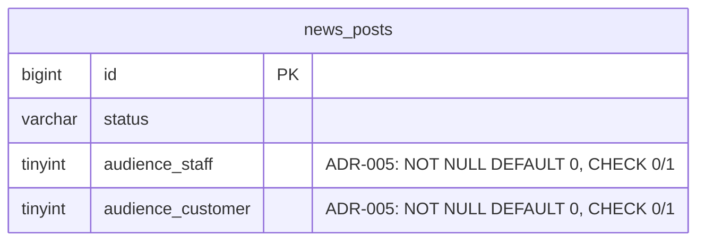

# Database hệ thống — nguồn chuẩn

**Bản chuẩn chủ repo cung cấp ngày 11/11/2026:** [sơ đồ database](../handover/evidence/system-database-reference-2026-11-11.jpg). Áp dụng cho toàn bộ dự án theo [rule database bắt buộc](../../.agents/rules/database-source-of-truth.md), không chỉ DT2-1. Runtime hiện được cấu hình dùng MySQL `smart_cafe`.

## Danh mục trong sơ đồ mới

| Nhóm | Bảng |
| --- | --- |
| Menu | `menu_categories`, `menu_items` |
| Vận hành | `cafe_tables`, `table_sessions`, `order_batches`, `order_items`, `session_clients`, `service_requests` |
| Thanh toán | `bills`, `bill_items`, `payments` |
| Tài khoản và xác thực | `users`, `staff_profiles`, `auth_otp_challenges`, `auth_otp_limits` |
| Nội dung và ảnh | `media_assets`, `news_posts`, `news_images`, `feedback`, `feedback_images` |

Tổng cộng **20 bảng**. Danh mục này giúp tìm nguồn, không thay DDL: tên/kiểu cột, nullability, khóa, default và giá trị trạng thái phải được đối chiếu chi tiết trước khi sử dụng. Không suy ra tất cả constraint/enum chỉ từ kiểu varchar hay đường nối trong ảnh. Ví dụ `session_clients.customer_user_id` và `feedback.customer_user_id` cho phép khách vãng lai theo ghi chú ảnh; không tự ép thành tài khoản đã đăng nhập. `feedback.rating` và `feedback.status` đã có trong bản mới, không tự tạo thêm trường tương tự.

## Quan hệ DT2-1 tái sử dụng

- `menu_categories` → `menu_items` → `media_assets`: tên/giá/ảnh/active/created_at.
- `menu_items` → `order_items` → `order_batches` → `table_sessions` → `cafe_tables`: top gọi nhiều và thông báo order đang chờ.
- `service_requests` → `table_sessions`/`session_clients`: thông báo gọi phục vụ.
- `users` → `staff_profiles`/`media_assets`: hồ sơ đúng người đăng nhập, role/status/auth_version tại DB quyết định quyền.

Không tạo bảng Header/Footer/notification trùng lặp. Không thêm trường hoặc thay FK/precision/constraint để khớp code. SQL `backend/src/test/resources/schema.sql` là fixture cấu trúc dùng cho DB test riêng, không phải migration hoặc nguồn có quyền thay thế sơ đồ chủ repo.

## Bằng chứng DDL và lịch sử đối chiếu

Lần kiểm tra DDL trước đây (06/11/2026) đã đọc `information_schema`/`SHOW CREATE` của database lúc đó: có 20 bảng và 4 view `v_menu_item_order_totals`, `v_paid_item_sales`, `v_daily_revenue`, `v_cafe_table_occupancy`. Fixture test lưu cấu trúc không chứa row; view bỏ definer và qualifier `smart_cafe` chỉ để chạy trong DB test riêng. Các view này có nguồn DDL được ghi nhận, không phải bảng nghiệp vụ bổ sung từ ảnh. Không tự tạo thêm view dựa trên suy đoán.

[Ảnh ngày 06/11](../handover/evidence/system-database-reference.png) chỉ giữ làm lịch sử: có `password_reset_tokens`, một số precision khác và `table_sessions.active_table_id`; các chi tiết này không có trong ảnh chuẩn mới, không dùng chúng để tự bổ sung schema. **Ảnh mới vẫn có `bills.current_session_id`**; trường này phải được đối chiếu riêng với DDL trước khi sử dụng, không được tự bỏ hoặc thêm vì dựa vào nhận xét của lần đối chiếu cũ. Những chênh lệch ghi nhận trước đây không chứng minh cấu trúc database ngày 11/11.

Lần cập nhật rule ngày 11/11 chỉ lưu/đối chiếu tài liệu và fixture đã có; **không đọc lại DB đang chạy, không xác nhận DB hiện tại khớp hoàn toàn sơ đồ mới và không chạy DDL/seed**. Task tiếp theo có persistence phải đọc DDL read-only, ghi chênh lệch cụ thể tại đây hoặc câu hỏi mở và dừng phần phụ thuộc cho tới khi được chốt. Đừng lấy bản fixture cũ để che chênh lệch.

## Khi cần bổ sung hoặc có chênh lệch

### Đối chiếu riêng DT2-7 ngày 11/11/2026

Trong vòng review local DT2-7, đã đọc `SHOW CREATE TABLE` bằng kết nối read-only ở mức thao tác (chỉ SELECT/SHOW) trên MySQL hệ thống 8.0.44 cho `news_posts`, `news_images`, `media_assets`, `users`. Các cột dùng bởi module, PK/FK/unique/CHECK, nullable và default khớp fixture cấu trúc hiện có; mô hình bốn bảng cũng khớp phần tương ứng trong ảnh 11/11. Không chạy DDL/seed hoặc ghi row vào database hệ thống.

Đối chiếu này **chỉ áp dụng bốn bảng trên**, không chứng minh tất cả bảng/view khác khớp sơ đồ mới. Fixture vẫn có nguồn chụp lịch sử ngày 06/11; lần đọc mới xác minh lại phạm vi DT2-7, không biến fixture thành nguồn thay thế DDL hệ thống. Bằng chứng DDL và so sánh được giữ ngoài repo trong hồ sơ review local theo yêu cầu chủ repo.

Module dùng `news_posts.version` sẵn có cho If-Match và lock hàng khi sửa/lưu trữ. DELETE chuyển `status='ARCHIVED'` sẵn có theo lựa chọn triển khai được chủ repo ủy quyền; không thêm `deleted_at`. Firebase upload dùng `media_assets` sẵn có, liên kết qua `news_images`; lần review đầu chưa thêm bảng/cột/index. Phần mở rộng audience được chấp thuận sau đó ghi riêng bên dưới. Hợp đồng và câu hỏi còn chờ khách hàng tại [DT2-7 backend](../handover/dt2-7-backend-contract.md).

### Mở rộng DT2-7 được chủ repo duyệt — ADR-005

DDL news_posts đọc lại ngày 11/11 xác nhận chưa có cột người nhận. Sau phản hồi Q&A 19–20, chủ repo đã duyệt rõ hai cột audience_staff/audience_customer sau khi xem phương án và nghe giải thích. Phần mở rộng được chấp thuận ghi tại [ADR-005](decisions.md); nguồn nghiệp vụ và phạm vi ở [phản hồi Q&A](../handover/dt2-7-qa-replies-2026-11-11.md).

| Cột mới | Kiểu/constraint | Ý nghĩa |
| --- | --- | --- |
| news_posts.audience_staff | TINYINT(1) NOT NULL DEFAULT 0 | STAFF được đọc khi PUBLISHED và cột bằng 1 |
| news_posts.audience_customer | TINYINT(1) NOT NULL DEFAULT 0 | CUSTOMER được đọc khi PUBLISHED và cột bằng 1 |

CHECK ck_news_audience_flags buộc hai cột thuộc 0/1. Bài cũ mặc định 0/0, ADMIN quản lý tới khi gán đối tượng; không tự mở toàn bộ dữ liệu cũ. Không thêm bảng/index hoặc thay cột có sẵn. Diagram mở rộng (phần còn lại giữ theo ảnh nguồn):

DDL versioned: backend/database/migrations/V20261111_01__news_audiences.sql. Application không chạy script hoặc SQL init khi startup. Fixture test gồm snapshot cũ cộng đúng ALTER đã duyệt; không dùng fixture để giả rằng DB hệ thống đã có hai cột. **Cập nhật theo ADR-006:** chủ repo sau đó yêu cầu áp dụng lên DB hệ thống. Đã chạy nguyên script trên smart_cafe local, xác minh hai cột TINYINT(1), NOT NULL DEFAULT 0, CHECK ck_news_audience_flags và định nghĩa các cột cũ không đổi. Digest các trường bài viết/liên kết ảnh trước và sau migration, sau kiểm tra HTTP đều khớp. Không seed hoặc tạo row nghiệp vụ. MySQL hệ thống 8.0.44 hiện đã có phần mở rộng này; không chạy lại ALTER nếu hai cột/constraint đã tồn tại.

Ghi task, nguồn ảnh/DDL và ngày đối chiếu, bảng/cột/constraint, khác biệt, hành vi bị ảnh hưởng, người cần quyết định và link kết luận. Trước khi có kết luận, không tự thêm migration, đổi entity để tạo schema, tắt constraint hay nạp dữ liệu cho code chạy tạm.

Giữ tiền decimal/BigDecimal và biểu diễn chính xác qua API theo DDL đã chốt. Dữ liệu kiểm thử chỉ ở `_test`; không tự tạo người dùng, đơn, thanh toán hay thông báo vào DB hệ thống để lấp UI. Việc nhập dữ liệu ngày 06/11 là [yêu cầu riêng đã ghi nhận của chủ repo](../handover/2026-11-06-owner-requested-home-data.md), không phải quyền seed mặc định cho các task khác.

## DT2-9 — đối chiếu ngày 11/11/2026 cho PR #8

Phần này giữ kết quả lịch sử của nhánh Menu trên cấu hình legacy riêng, được nhập từ main 8476ee3. Nó không mô tả DB smart_cafe đầy đủ đã đối chiếu cho Task 7 ở các phần trên; không dùng kết quả legacy để tự ALTER database hệ thống hiện tại.

Theo yêu cầu chủ repo, đã đọc cấu hình kết nối legacy và chạy SHOW CREATE TABLE / metadata read-only trên MySQL local 8.0.46; không đọc row nghiệp vụ hoặc thay đổi database. DB local hiện chỉ có `flyway_schema_history`, `menu_item_order_totals`, `menu_items`. Bảng món còn `price decimal(12,0)` và `image_url`, thiếu `category_id`, `image_media_id`, `available`, `version`; thiếu toàn bộ `menu_categories`, `media_assets`, `users`. Đây là DDL cũ, không khớp mô hình mới và không thể dùng để smoke module hiện tại.

Sau khi được báo chênh lệch, chủ repo gửi lại sơ đồ DB mới và xác nhận “tôi đã gửi sơ đồ db mới”. PR #8 lấy [sơ đồ ngày 11/11](../handover/evidence/system-database-reference-2026-11-11.jpg) làm mô hình đích: PK số, category_id, image_media_id, price decimal(18,0), media_assets; không có description hoặc cột image_url của menu_items. Không nâng cấp DB local, không thêm migration/runtime DDL. Fixture main giữ nguyên để provision schema *_test mới trên instance kiểm thử riêng. Constraint/default/index của fixture chỉ là điều kiện kiểm thử lịch sử, không được tuyên bố đã xác minh cho DB triển khai từ ảnh. Triển khai thực cần chủ DB cung cấp DDL phù hợp mô hình đích và đối chiếu lại trước khi chạy.
