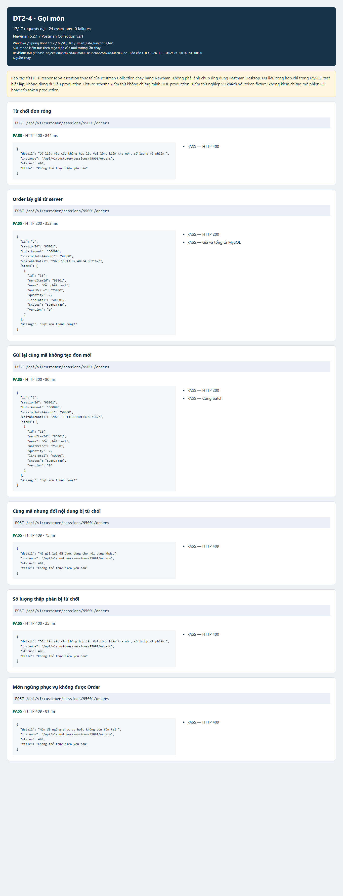
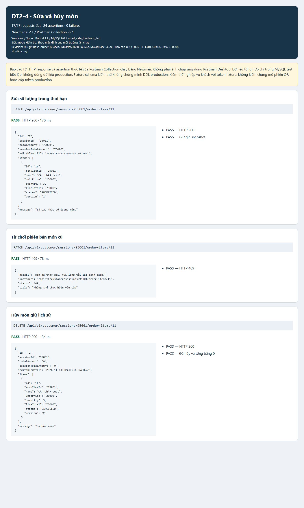
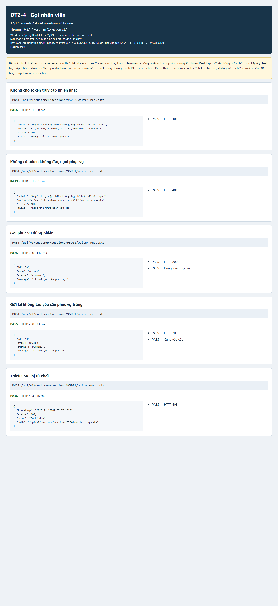
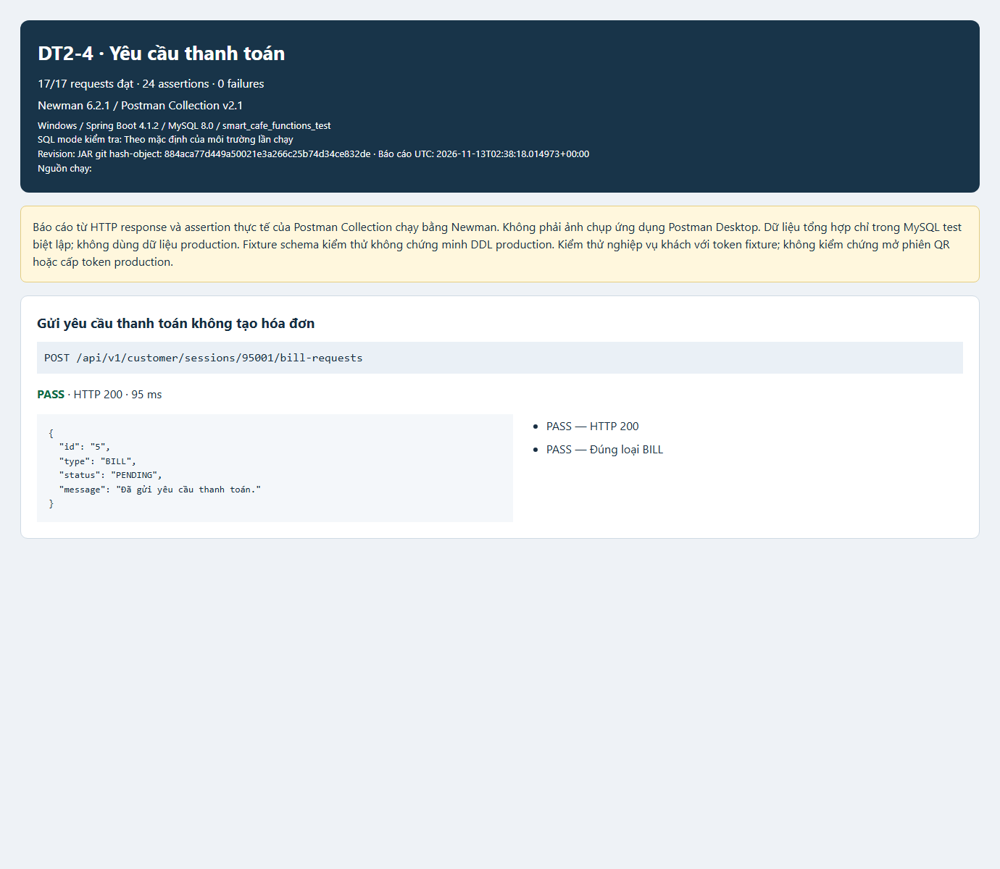
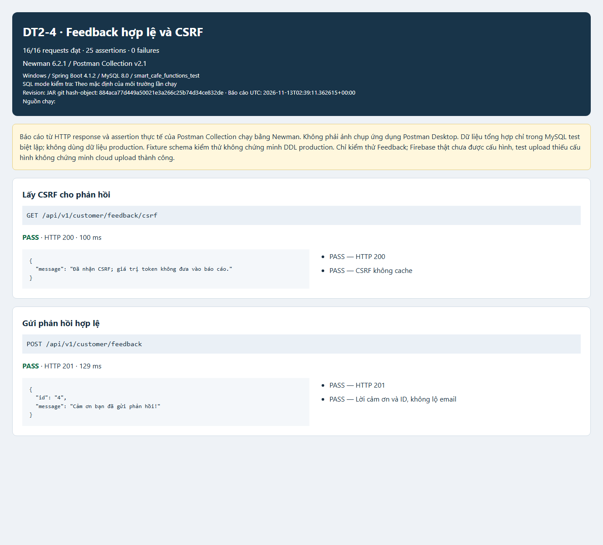
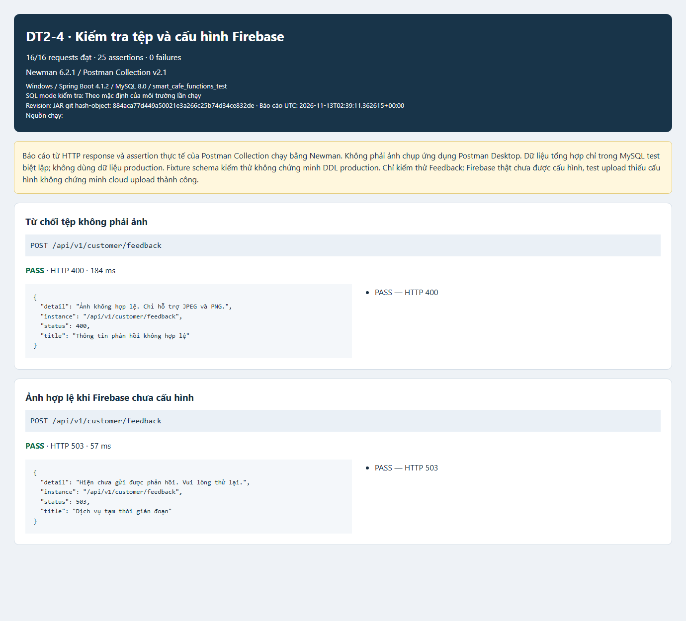

# DT2-4 — Các chức năng còn lại trên cùng nhánh

## Nguồn và phạm vi ngày 13/11/2026

- Chủ yêu cầu trong chat: dừng phát triển QR tại revision `77ddb61`; làm các chức năng còn lại trên nhánh riêng `feature/dt2-4_customer-workflows`, các yêu cầu backend, test/ảnh, review và không tự merge giữ nguyên. Hướng dẫn này thay yêu cầu tách branch/PR của prompt cũ, không thay nghiệp vụ.
- Prompt backend DT2-4 do chủ repo cung cấp trong attachment `b90e1587-1305-4077-a497-3c433c9e3876/Pasted text.txt`: Order, Sửa/Remove, Call Waiter, Bill request, Feedback, Firebase.
- Đã đọc lại [DT2-4](https://duymanhdnvn20092005.atlassian.net/browse/DT2-4) và [DT2-33](https://duymanhdnvn20092005.atlassian.net/browse/DT2-33). SRS gốc/Figma chưa được xác minh đầy đủ; không lấy ảnh làm quyết định nghiệp vụ.
- [15 ảnh gốc đã phân loại](evidence/dt2-4/reference/README.md): giỏ/Order (03,07,08,10,11), sửa số lượng (02,03), phục vụ (04,12,13), Bill (04,14,15), Feedback và đính kèm ảnh (05). Không làm frontend hoặc Mini Game.
- Chủ yêu cầu xác nhận xây dựng nghiệp vụ dùng `session_clients` hiện có; không làm lại bảng. Các API mới chỉ kiểm tra token đã được cấp và lưu, không phát token, không mở/tham gia phiên hoặc thay QR. Quyết định TTL/cơ chế cấp token của phần phiên vẫn thuộc phạm vi đang dừng.
- **QA-03 đã được chủ yêu cầu xác nhận:** trong 3 phút từ lúc server nhận Order, chỉ khi món chưa chuẩn bị; hết hạn hoặc đã chuẩn bị thì từ chối sửa/hủy. Trạng thái chờ trong schema là `SUBMITTED`, không tạo `PENDING` mới. Lưu `BEFORE_PREPARATION`, kiểm `editable_until` theo Clock server, ranh giới đúng 3 phút bị từ chối.
- **Firebase:** chủ yêu cầu cho chuẩn bị backend/cấu hình qua môi trường; project, bucket và credential do thành viên khác cung cấp. Không tự tạo project, bật billing, thay quyền bucket hoặc tuyên bố upload cloud PASS. DT2-5 được yêu cầu tạm dừng; chưa viết API quản lý phản hồi.

## Tiêu chí nghiệm thu và bằng chứng

| Chức năng | Kết quả cần kiểm chứng | Ảnh tham chiếu |
| --- | --- | --- |
| Order | Từ chối rỗng/số lượng sai; giá và tổng từ DB; snapshot tên/giá; một mã gửi lại chỉ có một batch; khác payload cùng mã bị 409; không ghi dở nếu một món không phục vụ; token không được ghi chéo phiên. | [Giỏ](evidence/dt2-4/reference/03-cart.png), [thành công](evidence/dt2-4/reference/07-order-success.png), [lỗi](evidence/dt2-4/reference/11-order-failure.png) |
| Sửa/Remove | Đúng người gửi, còn thời gian, món SUBMITTED; optimistic version chống ghi đè; dùng giá snapshot; hủy giữ lịch sử CANCELLED, không DELETE dòng. | [Chi tiết](evidence/dt2-4/reference/02-item-detail.png), [giỏ](evidence/dt2-4/reference/03-cart.png) |
| Call Waiter | Token/phiên hợp lệ; chống active request trùng theo constraint hiện có; Header và Sales đọc đúng sự kiện/bàn, không tạo bảng notification. | [Phục vụ](evidence/dt2-4/reference/04-service-requests.png), [thành công](evidence/dt2-4/reference/12-waiter-success.png), [lỗi](evidence/dt2-4/reference/13-waiter-failure.png) |
| Bill request | Có món hợp lệ; tạo service_requests loại BILL, không tạo bills/payments hoặc ghi nhận thu tiền; đúng phiên và mã gửi lại. | [Thành công](evidence/dt2-4/reference/14-bill-request-success.png), [lỗi](evidence/dt2-4/reference/15-bill-request-failure.png) |
| Feedback | Tên/email/nội dung/rating hợp lệ; UNREAD; khách vãng lai không giả user/session; CSRF và không mở GET/PUT/DELETE công khai; lỗi Việt hóa không lộ SQL/email. | [Feedback](evidence/dt2-4/reference/05-feedback.png) |
| Ảnh Feedback | Multipart cùng lúc gửi feedback, không attach vào ID tùy ý; JPEG/PNG thật, 1–3 ảnh, mỗi ảnh ≤5 MiB, kích thước ≤4096×4096; metadata/FK đúng; DB rollback và dọn object đã upload khi thất bại. Cloud thật chờ cấu hình. | [Vùng đính kèm](evidence/dt2-4/reference/05-feedback.png) |

Giới hạn upload là cấu hình kỹ thuật được thiết lập theo ủy quyền của chủ yêu cầu, không tuyên bố là giới hạn đọc được từ SRS. Firebase Admin SDK 9.11.0 theo [hướng dẫn chính thức](https://firebase.google.com/docs/admin/setup); dùng [Cloud Storage Admin](https://firebase.google.com/docs/storage/admin/start) và Application Default Credentials, không thay Firebase bằng Cloudinary.

## Hợp đồng và kiểm tra

- Maven verify trên MySQL Docker riêng đạt **89/89 test**, không lỗi hoặc skip. Các ca đồng thời, hết hạn, sai phiên và rollback đã chạy.
- Newman 6.2.1 chạy HTTP qua JAR thật. Nghiệp vụ khách đạt **17/17 request, 24/24 assertion**. Feedback đạt **16/16 request, 25/25 assertion**. Ảnh chụp dưới đây là báo cáo từ kết quả Newman; upload cloud còn chờ Firebase.

- [API nghiệp vụ khách](../api/dt2-4-customer-actions.md), [Feedback/Firebase](../api/dt2-4-feedback-api.md).
- [Postman nghiệp vụ khách](../qa/postman/dt2-4-customer-actions.postman_collection.json), [Feedback](../qa/postman/dt2-4-feedback-api.postman_collection.json).
- Test Java: `CustomerActionsMySqlTest`, `CustomerFeedbackMySqlTest`, `CustomerFeedbackUnavailableTest`, `FeedbackImagesTest`, `FeedbackImageMySqlTest`. Mock Firebase chỉ kiểm chứng biên adapter, cleanup và metadata MySQL; không chứng minh upload/download cloud thật.
- Container riêng `smart-cafe-dt24-functions-test`, MySQL 8.0; runtime `smart_cafe_functions_test`, Maven `smart_cafe_functions_verify_test`. Fixture cấu trúc hiện có không được trình bày thành DDL production mới.
- Tự review không thay hai review độc lập. Required check Git Flow đã có trên develop qua PR #12. Không tự merge vào develop/main, không sửa nguồn nghiệp vụ thuộc thành viên khác.

Skills theo phase: `cafe-requirements`, `cafe-workflow`; `cafe-spring-api`, `cafe-database`; `cafe-quality`, `cafe-review`, tại `.agents/skills/<identifier>/SKILL.md`.

## Ảnh báo cáo theo chức năng

