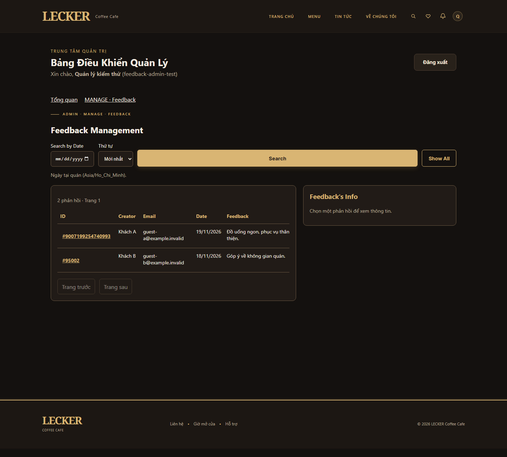
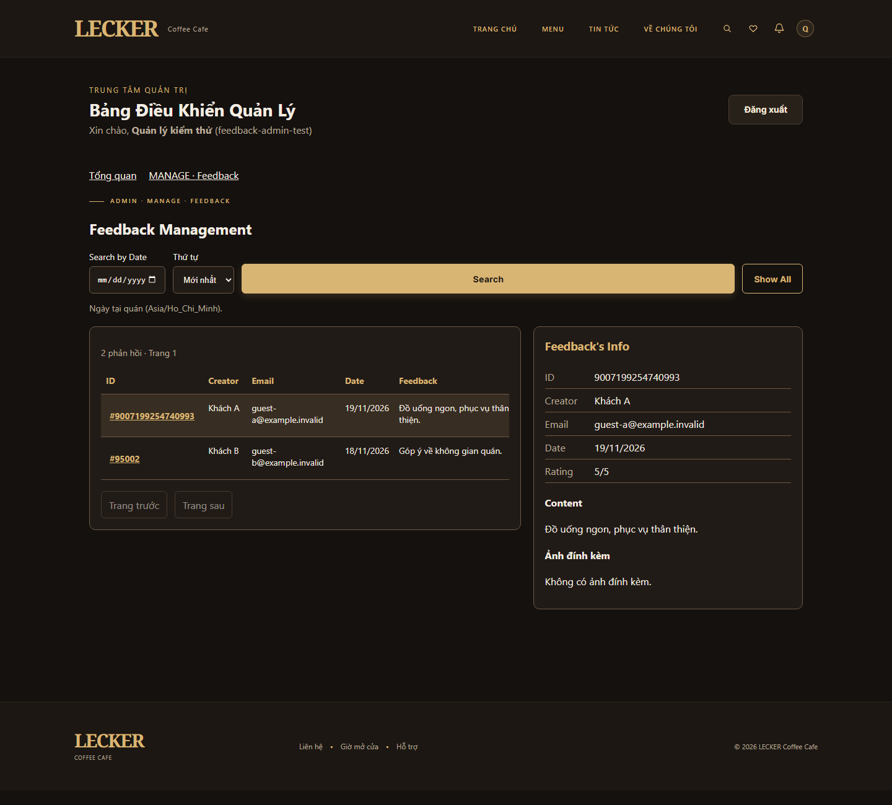
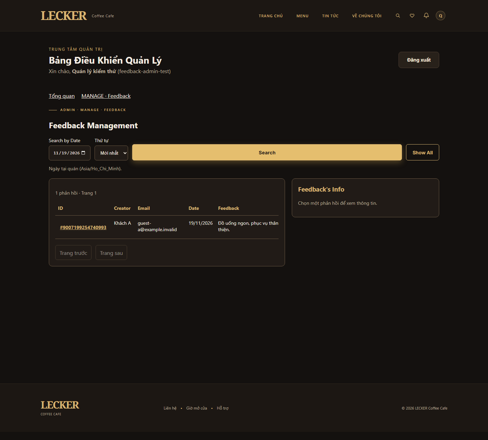
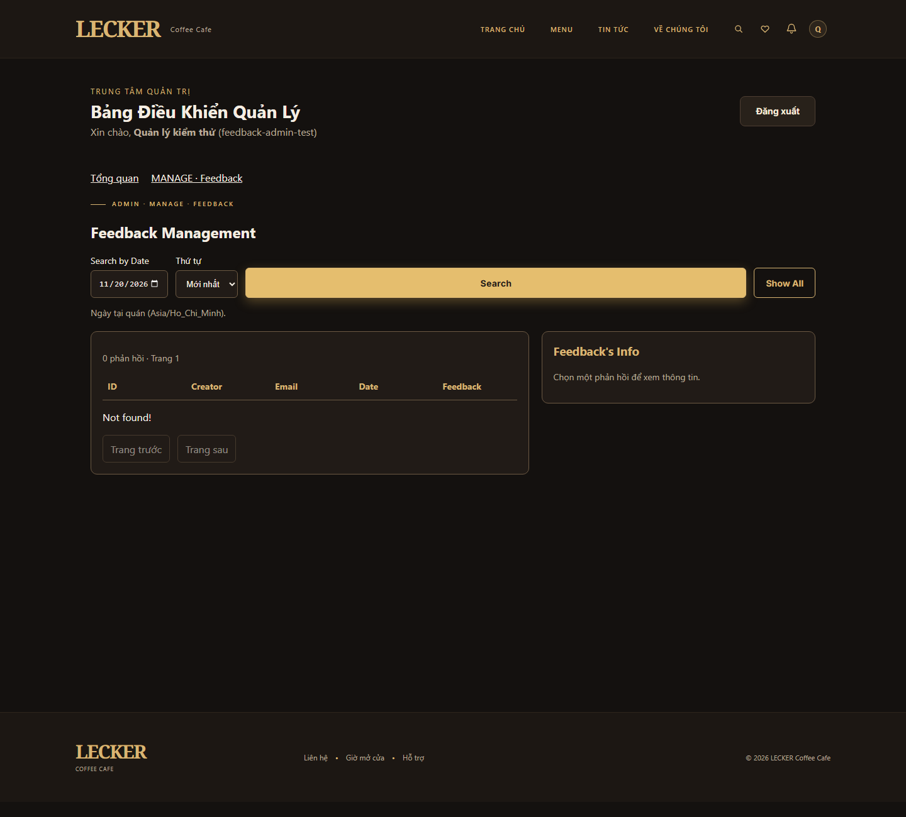
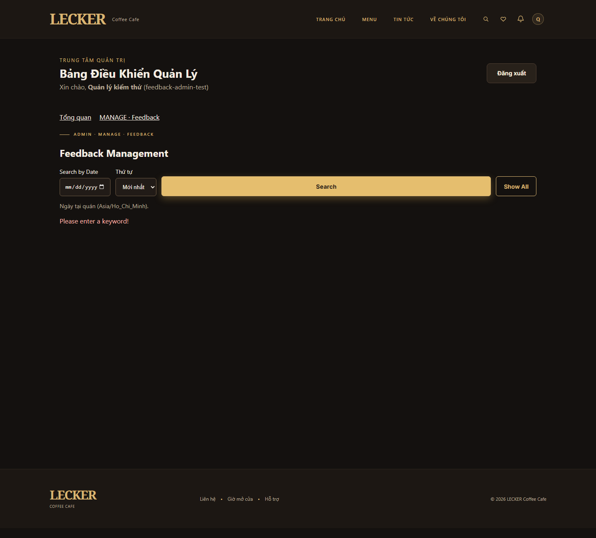
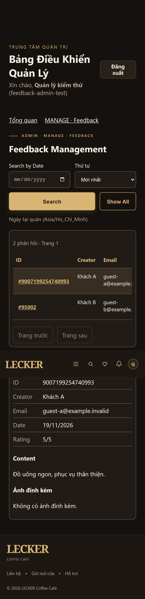
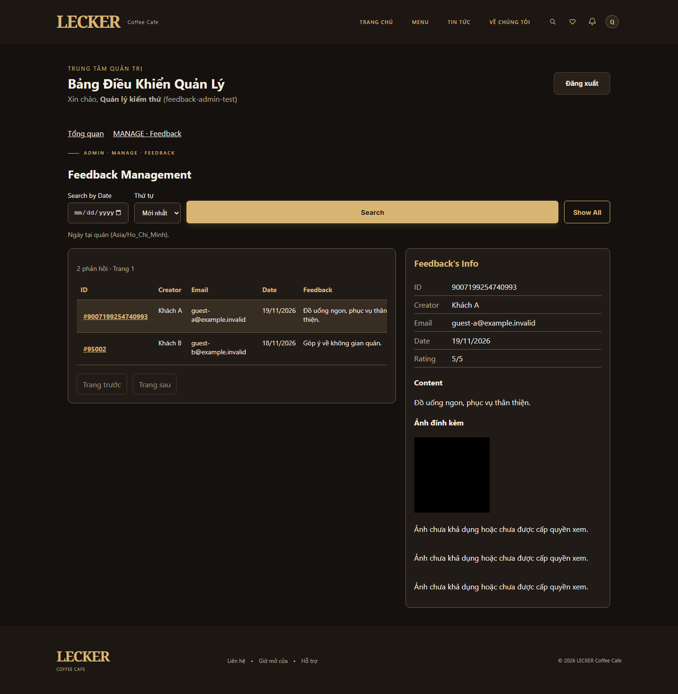
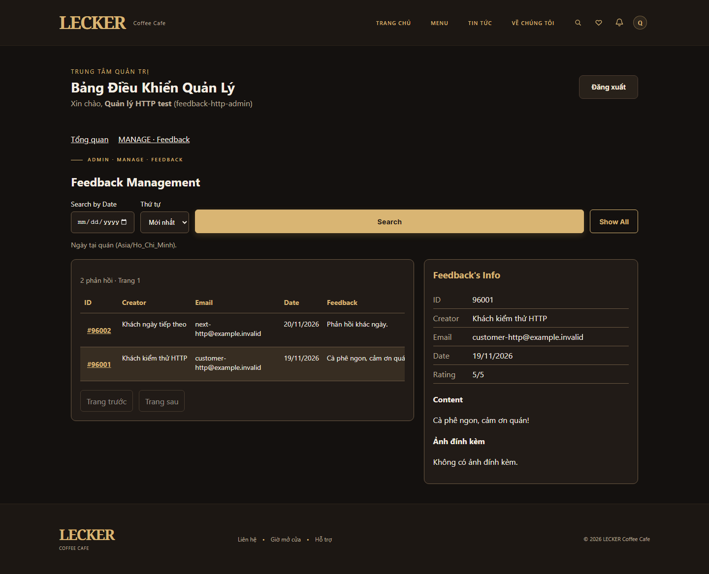
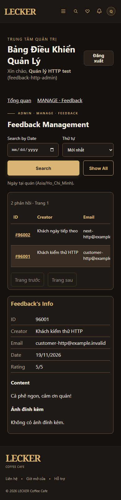

# DT2-5 — nội dung PR BE + FE

Nhánh: `feature/dt2-5_feedback-management` → `develop`.

Owner yêu cầu tạo PR ngày20/11/2026. #20 đã MERGED vào develop@9a88ba6, nhánh này đồng bộ sạch bằng merge4252dcf. Một PR chung BE+FE vào develop; không merge vào nhánh chung.

Tiêu đề owner đề xuất: `[DT2-5] Implement Feedback Management (Backend + Frontend)`. Khi đến bước mở PR cần đối chiếu convention/CF với repository; chưa tự gán CF hoặc sửa validator.

## A. Mục tiêu

Admin có thể đọc Feedback thật từ MySQL, chọn phản hồi để xem chi tiết, tìm theo ngày tại quán và trở về toàn bộ danh sách. UI có loading/error/empty; đổi bộ lọc hoặc lựa chọn không giữ chi tiết cũ, response đến muộn không ghi đè dữ liệu mới.

## B. Phạm vi

- Spring Boot: GET `/api/v1/admin/feedbacks` và `/{id}`, phân trang/sort/range ngày Asia/Ho_Chi_Minh; signed bearer và ADMIN theo cơ chế hiện có.
- ReactJS: Admin → MANAGE · Feedback, bảng 5 cột, Date input, Search, Show All, Feedback's Info, rating và metadata ảnh; dùng AdminDashboard/SiteLayout có sẵn.
- Database: chỉ đọc feedback/feedback_images/media_assets; **không đổi schema** hoặc seed application startup. Fixture tổng hợp chỉ trên *_test.
- Không Firebase/QR, không sửa/xóa phản hồi hay thay status, không sửa API gửi Feedback của DT2-4.
- Nguồn là prompt owner và quyết định ADMIN/ngày tại quán trong chat; chưa đối chiếu được Jira/SRS/Figma bằng tài khoản có quyền. Đây là giới hạn nghiệm thu thiết kế/nguồn, không được ghi đã pixel-match Figma.

## C. Bảng tiến độ

| Chức năng | Backend | Frontend | Test | Trạng thái |
| --- | --- | --- | --- | --- |
| Danh sách Feedback | MySQL, preview, sort/date/id, phân trang | 5 cột, trạng thái tải/lỗi/rỗng | MySQL + Playwright | Đã triển khai, đồng bộ develop chứa #20 |
| Xem chi tiết | ID dạng chuỗi, TEXT đầy đủ, rating | Panel Feedback's Info, không giữ A khi chọn B/lỗi | MySQL + race/404 | Đã triển khai |
| Search by Date | Khoảng UTC của ngày quán, half-open | Date input, thông báo đúng yêu cầu | Timezone boundaries + UI | Đã triển khai |
| Show All | GET không date | Xóa date, trang0, reset selection | UI + pagination | Đã triển khai |
| Hiển thị ảnh | Metadata join, bỏ deleted, URL HTTPS | Ảnh hợp lệ; fallback URL private/lỗi/không ảnh | Metadata + fixture image | Đã triển khai consumer; chưa nghiệm thu Firebase thật |
| Authorization | Token hợp lệ + role/status/version DB | Chặn anonymous/STAFF/CUSTOMER, lỗi401/403 | Signed bearer + UI | Đã triển khai theo auth hiện có |

## D. Ảnh minh chứng

Các ảnh sau dùng API mock (fixture tổng hợp), không phải bằng chứng Firebase thật. Có bản desktop/mobile cho từng trạng thái trong thư mục evidence.

| Danh sách | Chi tiết |
| --- | --- |
|  |  |
| Search thành công | Không có kết quả |
|  |  |
| Search trống | Show All |
|  |  |
| Mobile | Hiển thị ảnh fixture |
|  |  |

Trước khi publish, đổi link tương đối trong bảng thành URL ảnh trực tiếp theo branch/revision đúng; giữ ảnh nhúng, không chỉ đưa đường dẫn. Ảnh browser→Backend/MySQL thật được ghi riêng ở evidence/dt2-5/real nếu runner thực sự PASS.

## E. Kiểm thử và gate

Kết quả206/323 bên dưới thuộc giai đoạn A ở1f80506, chưa có #20. Candidate sau đồng bộ: lint/build PASS, unit6/6 PASS; Playwright259/260 (DT2-5 30/30), ca capture PNG DT2-4 lỗi ghi file Windows chạy lại riêng1/1 PASS. Backend compile + FeedbackReadUrlTest1/1 PASS. Docker engine local trả500, chưa chạy lại MySQL/HTTP; kết quả Backend MySQL/FE đầy đủ mới xem CI đúng HEAD Task5. Không dùng kết quả lịch sử thay kiểm chứng mới. Mã CF cho tiêu đề cần owner xác nhận, không tự gán hay đổi CI validator.

- Lint/build PASS; unit FE 5/5; Playwright toàn repository206/206, DT2-5 30/30 desktop/mobile (mock API, gồm axe).
- Backend focused16/16; Maven verify **323/323 PASS**, 0 skip. Browser→Spring Boot→MySQL thật **14/14 checks**, Newman **9/9 requests, 9/9 assertions PASS**. Chi tiết môi trường/lệnh/recovery tại [handoff](dt2-5-feedback-management.md).
- Không có CI PR DT2-5 vì chưa mở PR; không lấy CI #20 làm evidence cho nhánh này.
- Cần cập nhật commit SHA, checks và các số liệu sau đồng bộ với develop đã chứa #20. Reviewer độc lập và ruleset phải được đáp ứng; không tự approve/resolve/merge.

Ảnh HTTP thật (schema test riêng, không mock API/Firebase):

| Chi tiết desktop | Chi tiết mobile |
| --- | --- |
|  |  |
