# DT2-4 — Ảnh tham chiếu theo chức năng

Nguồn: `D:\ảnh task 4.zip`, do người dùng cung cấp ngày 11/11/2026. Đã xem và trích xuất đủ 15 PNG, giữ nguyên nội dung ảnh; chỉ đổi tên file để dễ tra cứu. `manifest.json` lưu tên gốc trong ZIP và SHA-256 của từng ảnh.

**Đây là ảnh thiết kế tham chiếu do người dùng cung cấp, không phải ảnh frontend đã triển khai hoặc bằng chứng API/Postman PASS.** Backend vẫn là phạm vi triển khai hiện tại. Ảnh không thay thế Jira/SRS hoặc DDL đã được duyệt.

## 1. Xem Menu — PR #9

- Danh mục, danh sách món: `GET /api/v1/customer/menu/categories`, `GET /api/v1/customer/menu/items`.
- Chi tiết món: `GET /api/v1/customer/menu/items/{itemId}`.
- Trạng thái đang tải là tham chiếu cho bên tiêu thụ API; PR backend không triển khai giao diện đó.
- Mô tả món có trong ảnh nhưng schema hiện tại không có `description`; không tự thêm cột hoặc bịa dữ liệu. Thao tác thêm vào giỏ/đặt món chưa thuộc PR Menu.

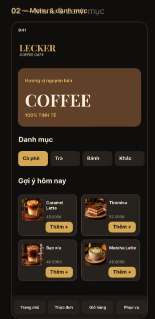
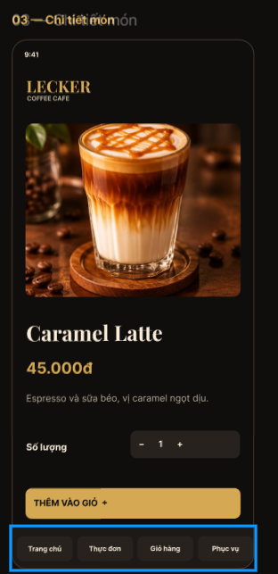
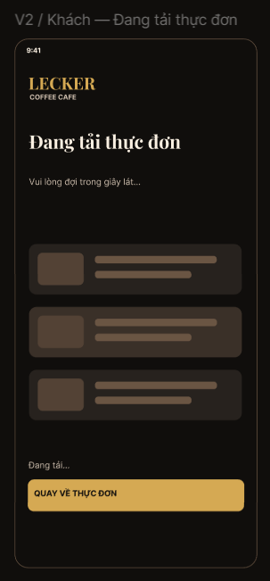

## 2. Xác định bàn và phiên khách hàng

ZIP không có ảnh riêng cho QR hoặc tham gia phiên bàn. Không tự tạo ảnh hay suy ra quy tắc mở phiên từ các màn hình khác; cần nguồn Jira/SRS và hợp đồng phiên được duyệt.

## 3. Gọi món — chưa triển khai trong PR #9

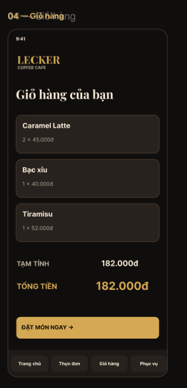
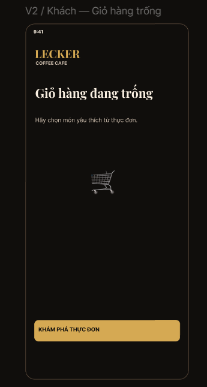
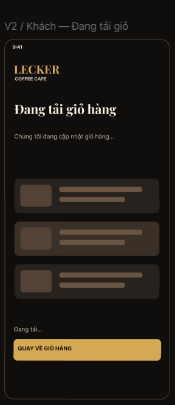
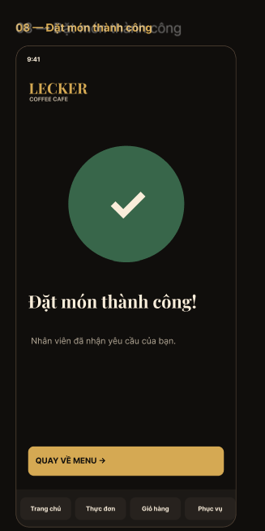
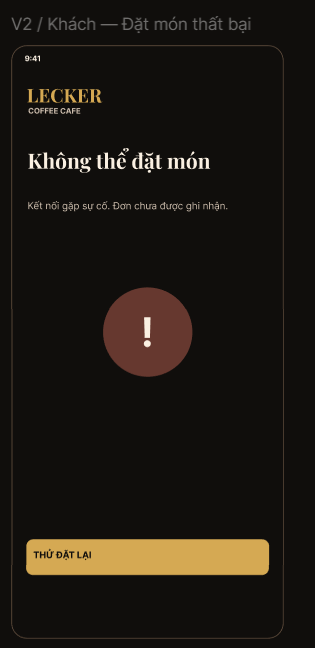

## 4. Sửa và Remove món — chưa triển khai trong PR #9

Tham chiếu [giỏ hàng](03-cart.png) và [chi tiết món/số lượng](02-item-detail.png). ZIP không có màn hình riêng cho thao tác sửa/hủy sau khi gửi đơn hoặc giới hạn 3 phút. Không coi ảnh là nguồn phê duyệt thời hạn/chính sách hủy.

## 5. Gọi nhân viên phục vụ — chưa triển khai trong PR #9

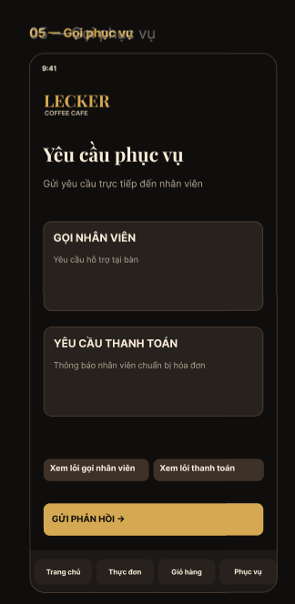
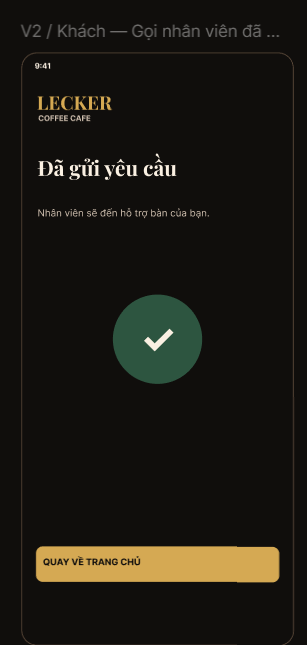
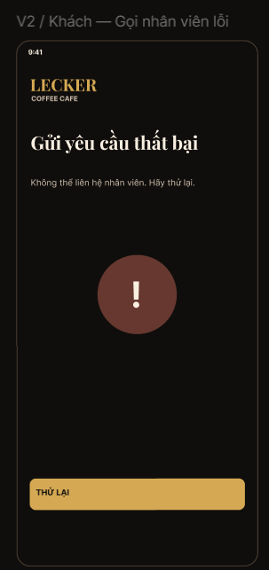

## 6. Yêu cầu thanh toán — chưa triển khai trong PR #9

Thao tác bắt đầu từ [màn hình yêu cầu phục vụ](04-service-requests.png). Đây là yêu cầu nhân viên mang hóa đơn, không phải bằng chứng thanh toán đã được ghi nhận.

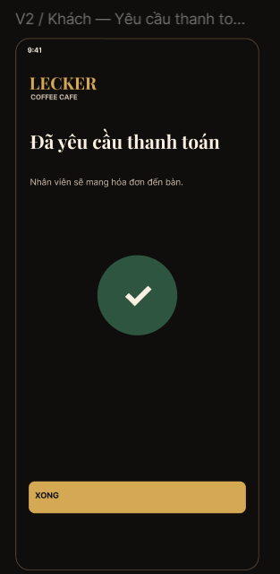
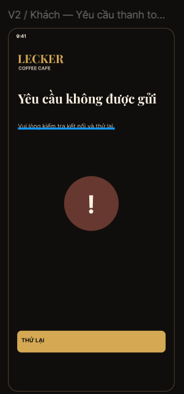

## 7. Gửi Feedback — chưa triển khai trong PR #9

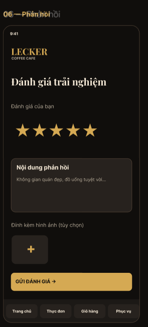

Ảnh thể hiện rating và nội dung; không có ô tên/email. Đối chiếu trường bắt buộc theo schema và yêu cầu đã duyệt trước triển khai.

## 8. Upload ảnh Feedback — chưa triển khai trong PR #9

Dùng cùng [ảnh phản hồi](05-feedback.png), vùng “Đính kèm hình ảnh (tùy chọn)”. ZIP không có màn hình upload riêng, lỗi upload hoặc giới hạn file; cần quy tắc được duyệt.

## Mini Game — ngoài phạm vi hiện tại

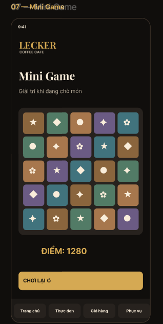
