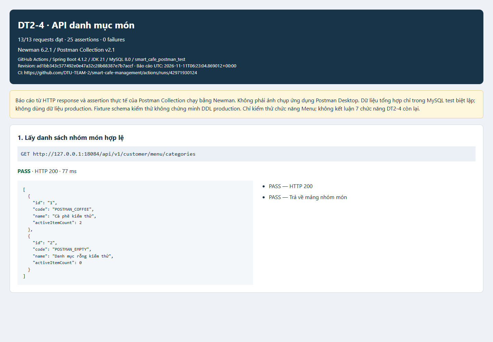
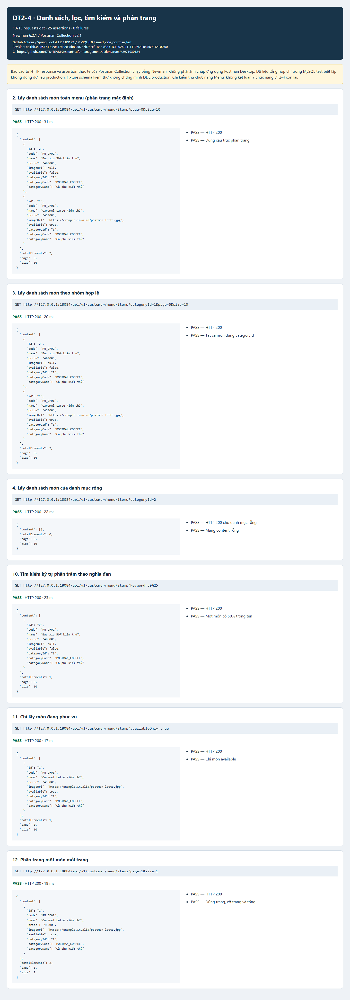
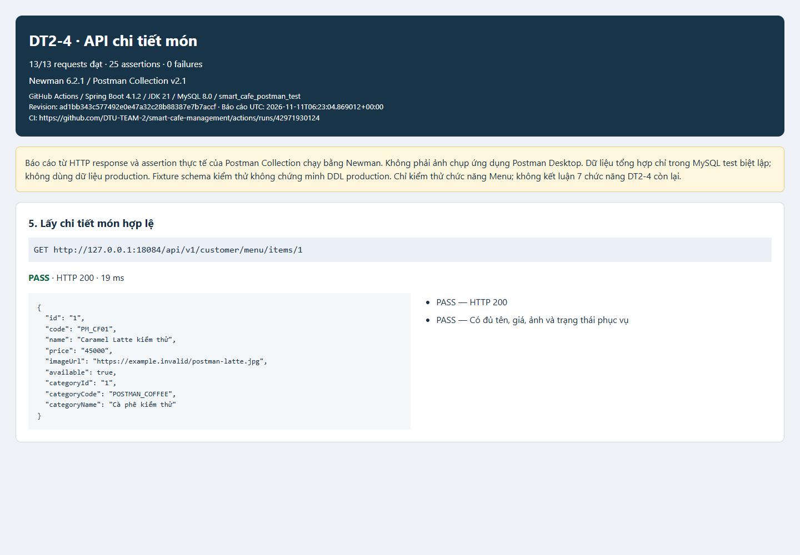
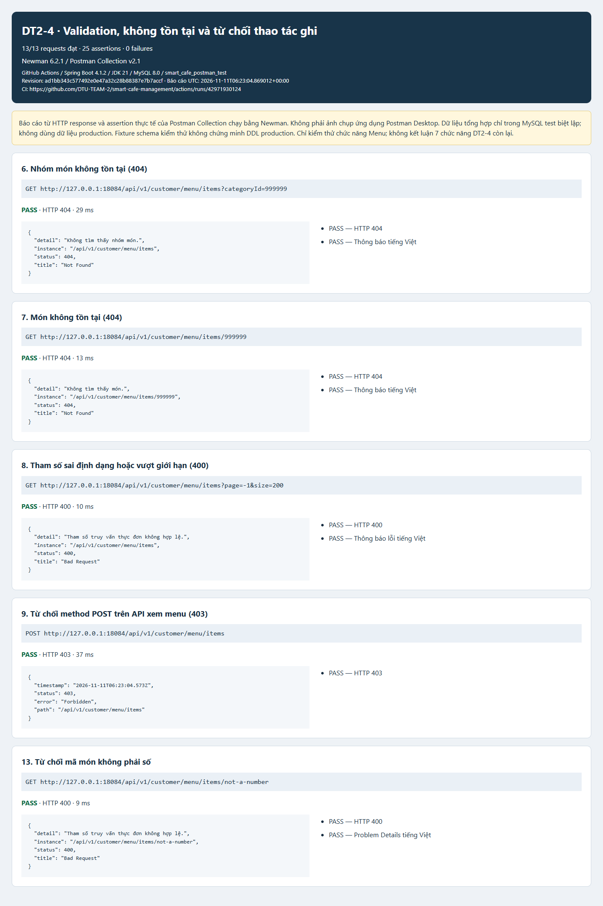

# DT2-4 — Kiểm thử Backend bằng Postman Collection

## Kết quả thực tế

- [Lần chạy GitHub Actions](https://github.com/DTU-TEAM-2/smart-cafe-management/actions/runs/42971930124), job `Customer Menu Postman HTTP`, ngày 11/11/2026.
- Revision kiểm thử: `ad1bb34` (SHA đầy đủ trong `results.json`).
- **13/13 request, 25/25 assertion PASS, 0 failure**.
- Runner: **Newman 6.2.1**, thực thi Postman Collection v2.1. Đây là ảnh báo cáo kết quả chạy collection, **không phải ảnh ứng dụng Postman Desktop**.
- Môi trường: GitHub Actions Ubuntu, JDK 21, Spring Boot 4.1.2/Tomcat thật trên loopback, MySQL 8.0 trong service riêng `smart_cafe_postman_test`.
- Chỉ dùng dữ liệu menu synthetic từ `docs/qa/postman/dt2-4-menu-test-fixture.sql` trong DB mới biệt lập. Không sửa hoặc seed DB hệ thống. Schema từ fixture kiểm thử hiện có; không kết luận đã đối chiếu DDL production.
- JSON rút gọn chứa request, status, thời gian, response body và assertion được trích nguyên dữ liệu từ Newman JSON của CI, không chứa headers/cookie/credential. `results.json` có timestamp, revision và run URL để đối chiếu. Artifact `dt2-4-postman` trong lần chạy trên lưu Newman JSON gốc.
- `request-urls.json` lưu nguyên method, URL đầy đủ (gồm query parameters) và status từ log CLI của cùng job; đã đối chiếu đúng thứ tự cả 13 request trước khi dựng ảnh.

## Ảnh theo nhóm API

### Danh mục



### Danh sách, nhóm món, danh mục rỗng, tìm kiếm, trạng thái phục vụ và phân trang



### Chi tiết món



### Lỗi và giới hạn quyền ghi



## Tái hiện

Workflow `.github/workflows/dt2-4-postman.yml` tạo service MySQL biệt lập, kiểm tra tên DB trước khi import cấu trúc và dữ liệu test, package backend, chạy server rồi thực thi:

```sh
npx --yes newman@6.2.1 run docs/qa/postman/dt2-4-menu-api.postman_collection.json \
  -e docs/qa/postman/smart-cafe-local.postman_environment.example.json \
  --env-var baseUrl=http://127.0.0.1:18084 \
  --timeout-request 10000 --timeout 120000 \
  -r cli,json --reporter-json-export backend/target/postman/newman.json
```

`scripts/render-customer-menu-postman.py` chuyển Newman JSON thành báo cáo JSON/HTML và giữ nguyên trạng thái thực tế. Bốn PNG là ảnh toàn trang của các HTML tương ứng, chụp bằng Playwright CLI với Edge. Chỉ dùng browser để chụp báo cáo, không xây dựng frontend ứng dụng.

```sh
python scripts/render-customer-menu-postman.py docs/reports/dt2-4-postman/results.json docs/reports/dt2-4-postman
npx --yes playwright@1.64.1 screenshot --channel msedge --full-page --viewport-size "1440,1000" file:///ABSOLUTE_PATH/01-categories.html 01-categories.png
```

## Giới hạn

Chỉ chứng minh chức năng Menu trên fixture MySQL test. Không có ca Postman cố tình làm mất DB để kiểm tra 503 trong lần chạy này; lỗi DB có test controller riêng, không cộng vào 25 assertion Newman. Các luồng QR/phiên, order, chỉnh/hủy, phục vụ, thanh toán, feedback và upload chưa được chứng minh bởi báo cáo này. Nguồn AC/DDL production còn thiếu vẫn cần chủ phụ trách đối chiếu trước nghiệm thu.
