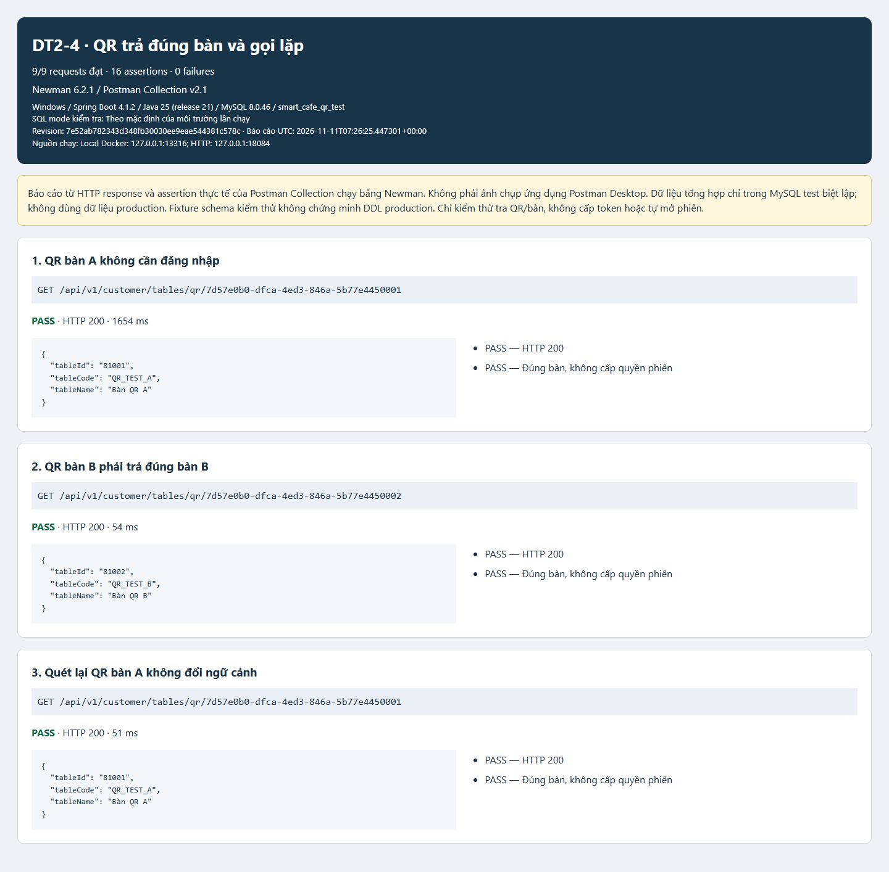
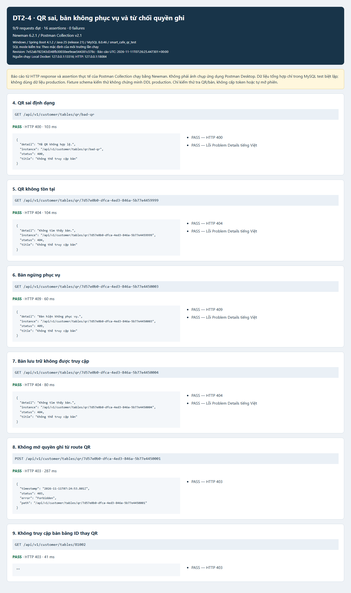

# DT2-4 — Bằng chứng tra bàn từ QR

## Môi trường thực tế ngày 11/11/2026

- Workspace: `D:\smart-cafe-management`, branch `feature/dt2-4-table-session`.
- Docker Desktop 29.4.1, container riêng `smart-cafe-dt24-qr-test`, MySQL 8.0.46; chỉ bind `127.0.0.1:13316`.
- Schema riêng `smart_cafe_qr_test` cho lượt Maven verify và HTTP; schema `smart_cafe_qr_verify_test` cho lượt kiểm tra bổ sung. Cả hai dùng fixture schema hiện có; không sửa DDL/row của DB hệ thống hoặc container dự án khác.
- Backend Spring Boot 4.1.2/Tomcat thật, Java 25.0.1 compile release 21, HTTP `127.0.0.1:18084`. JAR được build tại revision `7e52ab7`; commit `ce11d8f` không đổi source ứng dụng, chỉ bổ sung assertion/collection/tài liệu/hạ tầng test. CI tiếp tục kiểm tra trên JDK 21 theo cấu hình repo.

## Kết quả đã quan sát

- Maven verify local với MySQL thật: **65/65 test đạt, 0 failure/error/skip**. Test QR gồm 4 controller tests và 1 MySQL integration test. Chạy Mockito javaagent tường minh để không treo self-attach trên Java 25.
- Sau bổ sung assertion đếm `session_clients`, chạy lại riêng `CustomerTableMySqlTest` tại `ce11d8f` trên schema `smart_cafe_qr_verify_test`: **1/1 đạt**, 0 failure/error/skip. Không cộng lượt chạy này vào 65 test của lượt verify trước đó.
- Postman Collection chạy bằng **Newman 6.2.1**: **9/9 request, 16/16 assertion đạt**, 0 failure. HTTP thật, không mock API. Đây là báo cáo Newman, không phải ảnh giao diện Postman Desktop.
- Gọi lặp QR bàn A vẫn trả A, QR bàn B trả B; không có session hoặc token trong response. Kiểm tra DB sau lượt HTTP: `table_sessions=0`, `session_clients=0`.
- 400 sai QR, 404 QR không tồn tại/bàn lưu trữ, 409 bàn ngừng phục vụ; POST QR và GET bàn bằng ID số bị 403.
- Registry, 9 routing tests và whitespace đạt ở lượt chuẩn bị commit. Các báo cáo không chứa credential hoặc dữ liệu khách thật.

### Đúng bàn và gọi lặp



### QR không hợp lệ, trạng thái bàn và giới hạn quyền



`results.json` là dữ liệu rút gọn từ `backend/target/qr-newman.json` của lượt chạy thật: method, URL, status, response body, thời gian và assertion; không chứa headers/cookies/secrets. HTML và PNG được dựng từ JSON đó; PNG chụp toàn trang bằng Edge/Playwright, không dựng giao diện giả của Postman.

## Chạy lại bằng Postman Desktop

Import `docs/qa/postman/dt2-4-qr-api.postman_collection.json`, dùng biến collection `baseUrl=http://127.0.0.1:18084`. Backend và DB test cần đang chạy với fixture `docs/qa/postman/dt2-4-qr-test-fixture.sql`. Không đổi baseUrl sang DB/ứng dụng production để chạy fixture.

Ví dụ API local của bàn test A:

```text
GET http://127.0.0.1:18084/api/v1/customer/tables/qr/7d57e0b0-dfca-4ed3-846a-5b77e4450001
```

Chạy cùng collection qua CLI:

```sh
npx --yes --prefer-offline newman@6.2.1 run docs/qa/postman/dt2-4-qr-api.postman_collection.json --timeout-request 10000 --timeout 120000 -r cli,json --reporter-json-export backend/target/qr-newman.json
```

Renderer có `--feature qr` và `--environment` để phân biệt đúng nhóm API/môi trường; không thay các ảnh Menu đã kiểm chứng ở PR #9.

## Chưa hoàn thành

Đây là **phần nhận diện bàn từ QR**, chưa phải đầy đủ chức năng phiên khách hàng. GET không ghi dữ liệu nên không tự mở phiên khi quét. Chưa cấp/kiểm tra token order hoặc chống đặt món chéo bàn. Mong muốn khách quét và dùng ngay đã ghi nhận, nhưng việc mở phiên vãng lai bị ràng buộc bởi `opened_by_user_id NOT NULL` và QA-02 chưa chốt. Xem [bàn giao và quyết định còn thiếu](../../handover/dt2-4-table-session.md). Không tự thêm account giả hoặc đổi schema để vượt blocker.
