# DT2-9 — bằng chứng tích hợp và ảnh PR

Chụp ngày 20/11/2026 từ `MenuBrowserIntegrationTest`: Chromium → Vite proxy → Spring Boot/Tomcat → MySQL 8.0.46, schema riêng `smart_cafe_menu_20261120_test`. Auth đăng nhập thật bằng user fixture chỉ có trong schema test; không mock application API, không dùng dữ liệu nghiệp vụ. Test dọn dữ liệu sau lượt chạy.

Provider upload HTTP và ảnh CDN được giả lập, không phải Cloudinary thật. Các ô màu là ảnh kiểm thử, không phải ảnh món từ tài khoản Cloudinary. Desktop 1440×1000, mobile viewport 390×844 trên Chromium; không tuyên bố kiểm thử Safari/thiết bị thật.

| Màn hình | Desktop | Mobile |
| --- | --- | --- |
| Thêm nhóm món | 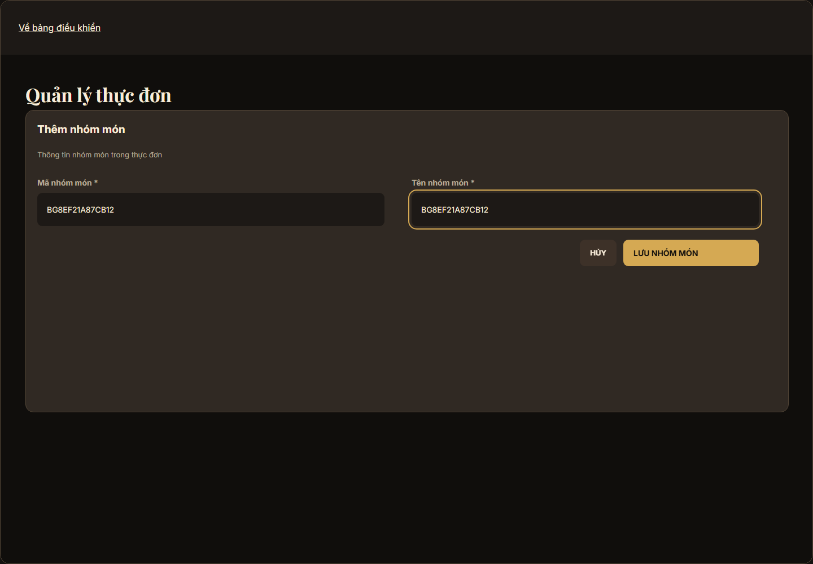 | 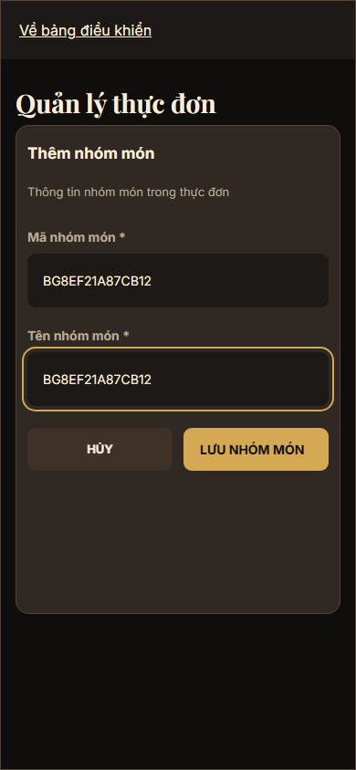 |
| Danh sách nhóm sau lưu | 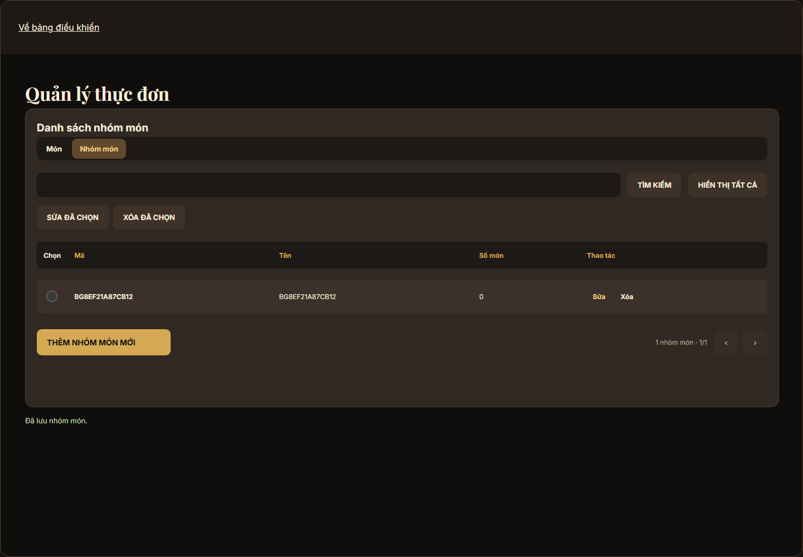 | 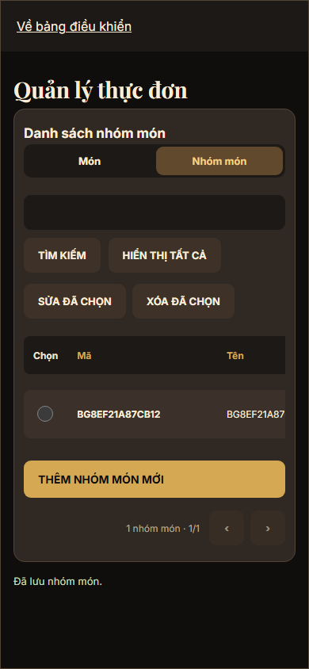 |
| Thêm món và chọn ảnh | 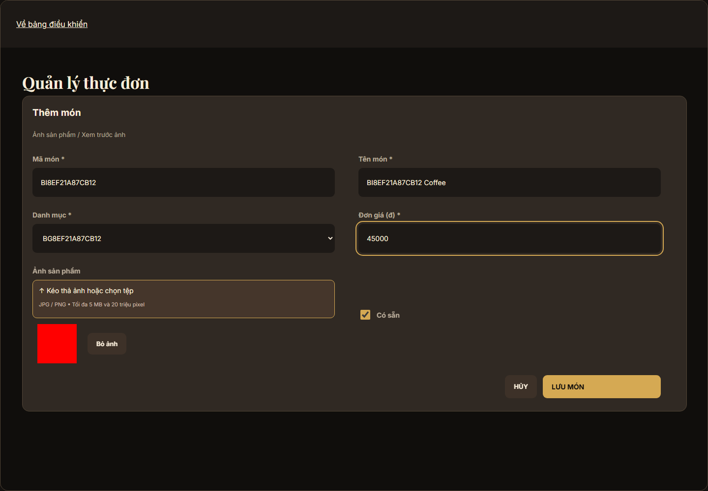 | 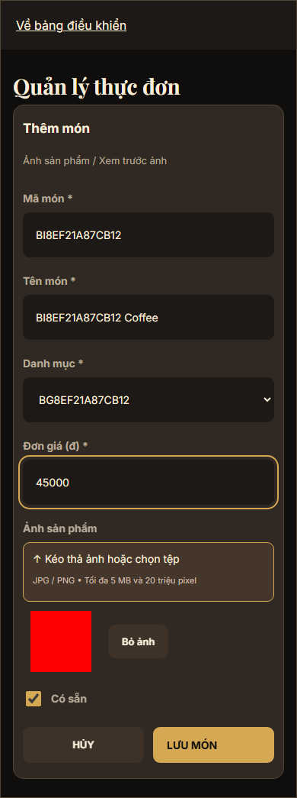 |
| Danh sách món sau lưu API | 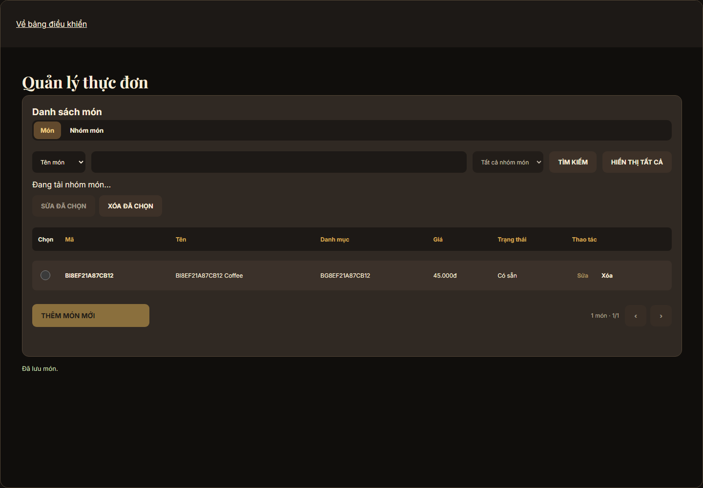 | 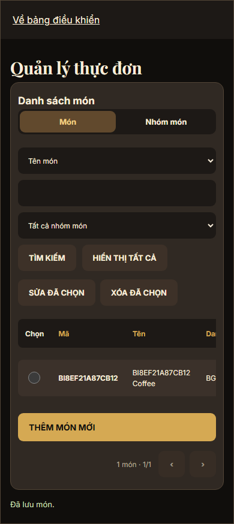 |
| Sửa giá/thay ảnh món | 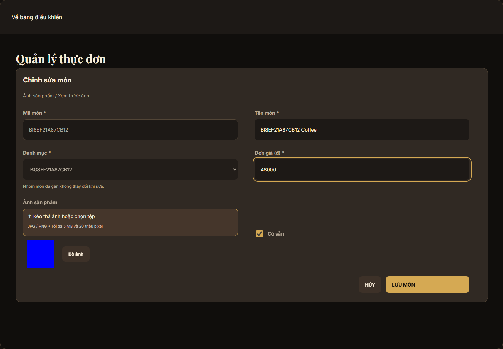 | 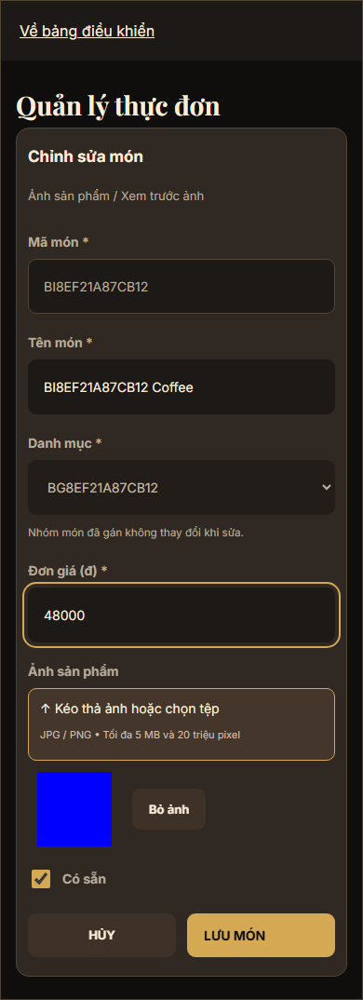 |
| Menu khách đọc ảnh/giá đã sửa | 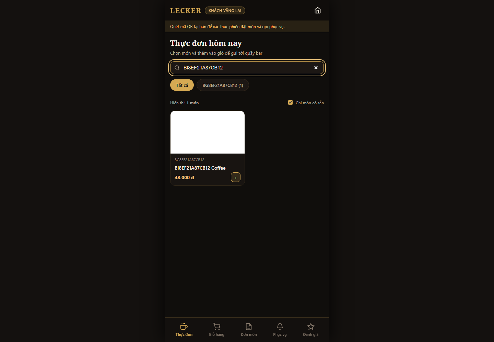 | 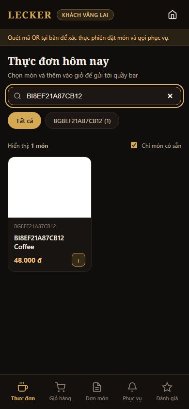 |
| Xác nhận xóa nhóm có món | 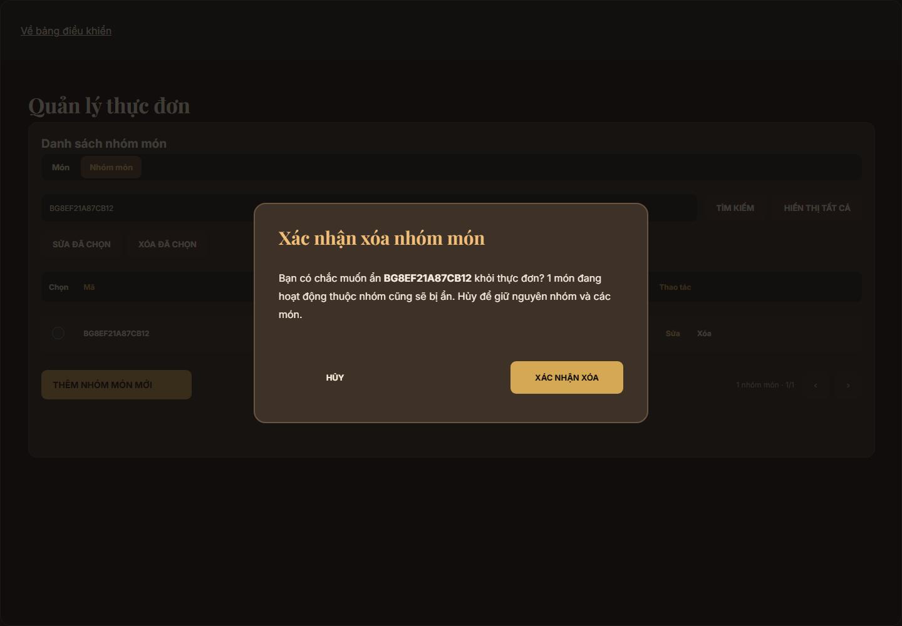 | 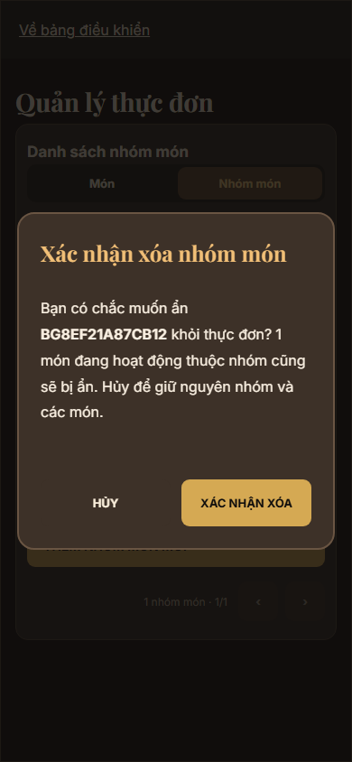 |

## Kết quả thực chạy

| Kiểm tra | Kết quả | Phạm vi |
| --- | --- | --- |
| `npm run lint`, `npm run build` | Đạt | Mã sản phẩm; lint chạy lại sau thêm capture |
| `npm run test:ui -- --workers=2` | 236/236 Playwright, 5/5 unit | Hồi quy desktop/mobile; application API có fixture |
| `npm run test:ui -- tests/menu-admin.spec.js --workers=2` | 8/8 Playwright | Quyền STAFF, giá 18 chữ số/version, hủy/xóa stale, lỗi upload/retry không upload trùng |
| `MENU_BROWSER_TEST=true`, `mvnw.cmd -o -B -ntp verify` | 320/320 JUnit, 0 failures/errors/skips | MySQL test thật và browser E2E; provider ảnh giả lập |
| `MenuHttpReportTest` trong verify | 46/46 mục HTTP PASS | HTTP Spring/MySQL; không cộng vào số JUnit |
| `mvnw.cmd -o -B -ntp -Dtest=MenuBrowserIntegrationTest test` sau thêm capture | 1/1 đạt, 27.737 giây, kết thúc 09:09:46 +07:00 | Tạo 14 PNG ở trên; kiểm tra thêm/sửa/reload/ảnh khách/xóa liên quan |

Lượt verify toàn bộ kết thúc 09:02:38 +07:00; chỉ thêm chức năng capture vào script kiểm thử sau lượt này, không sửa mã sản phẩm. Artifact local: `backend/target-menu-verify.log`, `backend/target-menu-evidence.log`, `backend/target/menu-browser.log`, `backend/target/surefire-reports/`, `backend/target/api-report/dt2-9-api-results.json`; không đưa log/token/credentials vào Git.

## Giới hạn

- Chưa smoke Cloudinary thật vì chưa có cấu hình; không đánh dấu tiêu chí provider thật đã đạt.
- Không migrate/seed database hệ thống; không chứng minh DDL môi trường triển khai đã sẵn sàng.
- CI GitHub và hai approval độc lập phải xác minh riêng trên head PR; local PASS không thay review hoặc triển khai.
- Nguồn code CF-14 giữ nguyên author và cherry-pick provenance trong [bàn giao](../../handover/dt2-64-menu-integration-2026-11-20.md). Skills: cafe-workflow và cafe-quality tại `.agents/skills/<identifier>/SKILL.md` cho handoff và kiểm chứng.
